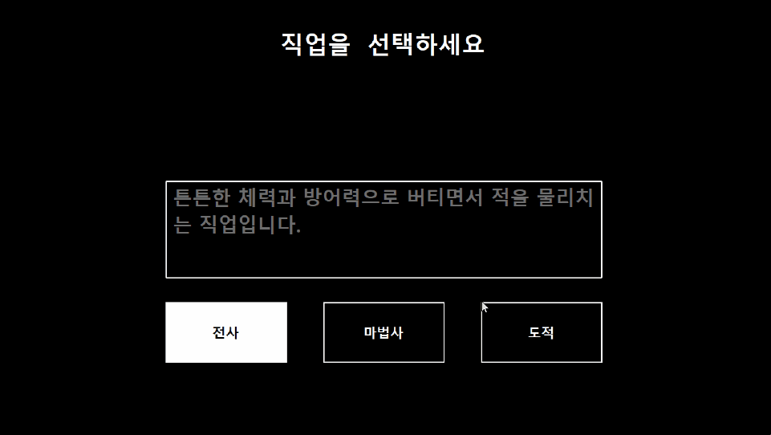
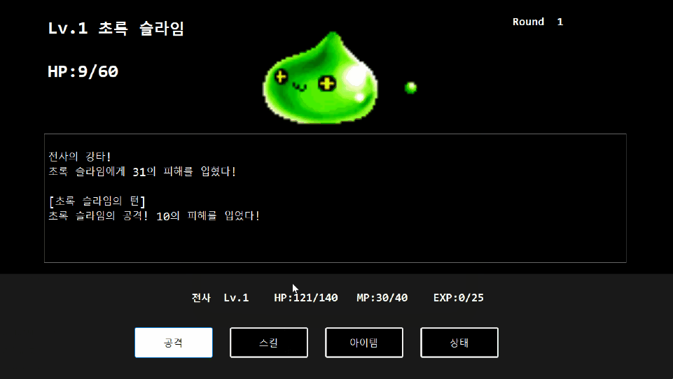
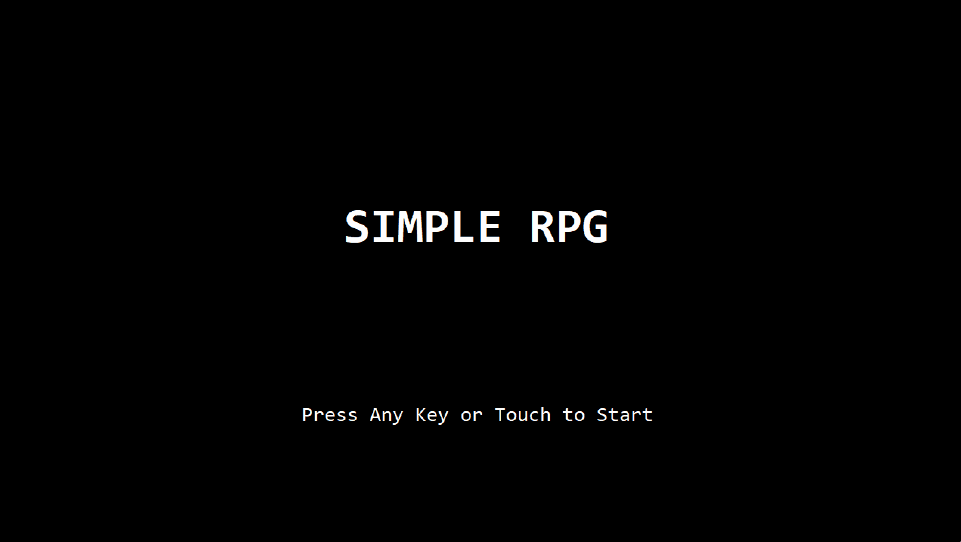

# Simple RPG

C#과 Windows Forms로 만든 **턴제 로그라이크 RPG**입니다.
직업을 골라 8라운드의 몬스터를 차례로 쓰러뜨리고, 마지막 드래곤을 잡으면 클리어합니다.

| 직업 선택 | 전투 |
| --- | --- |
|  |  |



## 프로젝트 정보

| 항목 | 내용 |
| --- | --- |
| 기간 | [2025.10.16 ~ 2025.11.26] (6주, [C# 프로그래밍] 팀 프로젝트) |
| 인원 | 2명 |
| 내 역할 | 구현 전체: 전투 로직, 사운드·이미지 처리, 화면 전환, 클래스 설계 |
| 팀원 역할 | UI/UX 디자인, 게임 밸런스 |
| 기술 | C#, .NET 8, Windows Forms, Windows Media Player(COM) |

## 주요 기능

- **직업 3종:** 전사(체력·방어력), 마법사(공격력·마나), 도적(20% 확률 회피)
- **8라운드 전투:** 슬라임부터 최종 보스 드래곤까지 라운드마다 강해지는 몬스터
- **성장:** 경험치와 레벨업, 레벨에 따라 배우는 스킬 8종
- **아이템 5종:** 체력·마나 회복, 공격력 버프(5턴). 몬스터 처치 시 70% 확률로 1~3개 드롭
- **연출:** 피격·사망 이미지, 배경음악과 효과음 동시 재생
- **키보드 조작:** 선택된 버튼 강조 표시

## 실행 방법

1. Windows 10/11, Visual Studio 2022(.NET 데스크톱 개발 워크로드), .NET 8 SDK를 준비합니다.
2. 저장소를 내려받고 `Team_Project.sln`을 엽니다.
3. `F5`로 실행합니다.

> 게임 리소스(몬스터 이미지·사운드)는 저작권 문제로 저장소에 포함하지 않았습니다.
> 리소스 없이도 실행되지만 몬스터 이미지와 소리는 나오지 않고, 전투 로그에 이미지 로드 경고가 표시됩니다.
> 실제 플레이 모습은 위의 스크린샷과 영상으로 확인해 주세요.

> 사운드에 Windows Media Player를 사용하므로, Windows N 에디션에서는 미디어 기능 팩이 필요합니다.

## 조작법

| 화면 | 조작 |
| --- | --- |
| 시작 | 아무 키 또는 클릭: 시작 / `ESC`: 종료 |
| 전투 | 마우스, 또는 `Tab`·방향키로 이동하고 `Enter`·`Space`로 선택 |
| 스킬·아이템·상태 창 | `ESC`: 닫기 |

## 구조

화면(View), 진행(Controller), 데이터와 규칙(Model)을 나눴습니다.
`BattleManager`는 화면을 `IBattleView` 인터페이스로만 다루므로, 전투 로직을 화면 없이 테스트할 수 있습니다.

```
Team_Project/
├─ Program.cs              진입점: 사운드 등록 후 시작 화면 실행
├─ Model/                  데이터와 규칙 (다른 계층을 호출하지 않음)
│  ├─ Character.cs         플레이어·몬스터 공통 부모(추상), 피해 공식
│  ├─ Player.cs            경험치·레벨업, 스킬, 인벤토리, 버프
│  ├─ Job.cs               전사·마법사·도적
│  └─ Monster.cs, Skill.cs, Item.cs
├─ Controller/             진행과 자원 관리
│  ├─ BattleManager.cs     전투 규칙 (공격, 반격, 승리·패배 판정)
│  ├─ IBattleView.cs       BattleManager가 화면에 요청하는 기능
│  ├─ MonsterManager.cs    라운드별 몬스터 데이터
│  ├─ SkillManager.cs      직업별 스킬 데이터
│  ├─ ItemManager.cs       아이템 데이터, 드롭
│  ├─ SoundManager.cs      배경음악·효과음 (싱글톤)
│  └─ ImageManager.cs      이미지 로드
├─ View/                   Windows Forms 화면
│  ├─ GameForm.cs          게임 화면 공통 부모 (화면 전환, 종료 처리)
│  ├─ StartForm.cs, JobSelectForm.cs, BattleForm.cs
│  ├─ SkillForm.cs, ItemForm.cs, StatusForm.cs
│  └─ GameOverForm.cs, ClearForm.cs, FocusManager.cs
├─ Image/                  몬스터 이미지 (저장소에는 미포함)
└─ Sound/                  배경음악·효과음 (저장소에는 미포함)
```

### 전투 한 턴

1. 버튼을 누르면 `BattleForm`이 `BattleManager`에 행동을 전달합니다.
2. 행동이 시작되면 버튼을 잠가 연속 입력을 막습니다.
3. 피해를 계산합니다: `공격력 × 50 / (50 + 방어력) × 0.9~1.1`
4. `NextTurn()`이 몬스터 반격 → 플레이어 사망 확인 → 몬스터 처치·클리어 확인을 차례로 처리합니다.

## 트러블슈팅

**효과음이 배경음악과 함께 나오지 않음**
- 원인: 플레이어 하나는 한 번에 한 소리만 재생합니다.
- 해결: 배경음악 전용 플레이어와 효과음 플레이어를 나누고, 효과음은 미리 만든 4개를 돌려 쓰는 풀 방식으로 바꿨습니다.

**이미지가 불러와지지 않음**
<!-- 당시 실제 원인과 맞는지 확인해 주세요 -->
- 원인: 상대 경로가 실행 위치에 따라 다르게 해석되었습니다.
- 해결: 실행 파일 위치를 기준으로 경로를 만들고, 리소스가 빌드 폴더에 복사되도록 설정했습니다. 로드에 실패하면 원인을 로그로 남깁니다.

**공격·클리어 판정 오류**
<!-- 당시 실제 원인과 맞는지 확인해 주세요 -->
- 원인: 턴 처리 코드가 여러 곳에 흩어져 판정 순서가 꼬였습니다.
- 해결: 턴 처리를 `NextTurn()` 하나로 모으고, 몬스터 턴에는 입력을 잠갔습니다.

## 리팩터링 (2026.1)

수업이 끝난 뒤 코드를 다시 읽으며 고친 내용입니다. 깃허브에는 올리지 않았기에 커밋 기록에는 남지 않았습니다.

| 문제 | 개선 |
| --- | --- |
| 클리어 화면에 "GAME OVER"가 표시됨 | 제목을 덮어쓰던 코드 제거 |
| 아이템 사용 후 몬스터 턴에도 공격 가능 | 모든 행동에서 시작 직후 입력 잠금 |
| 경험치가 충분해도 레벨이 1씩만 오름 | 오른 레벨 수만큼 반복해서 레벨업 |
| 6라운드 피격 이미지 누락 | 파일 이름 오타 수정, 이미지 로드 실패를 로그로 기록 |
| 라운드가 바뀌어도 화면에 계속 "Round 1" 표시 | 전투를 시작할 때마다 라운드 라벨 갱신 |
| 일부 창은 크기 조절이 가능해 늘리면 배치가 어긋남 | 모든 창을 1280×720 고정 크기로 통일 |
| Model이 사운드 관리자를 직접 호출 | 레벨업 소리를 Controller로 옮겨 계층 의존 방향 정리 |
| BattleManager가 BattleForm에 직접 의존 | `IBattleView` 인터페이스 도입 |
| 다시 하기를 할 때마다 숨은 창이 쌓임 | 공통 부모 `GameForm`에서 화면 전환 시 창을 닫도록 변경 |
| 효과음마다 COM 객체를 새로 만들고 해제하지 않음 | 플레이어 풀로 재사용 |

## 배운 점

- 기능을 클래스로 나누면 오류가 생겨도 고칠 곳을 빨리 찾을 수 있습니다.
- 예외를 그냥 무시하면 문제가 숨습니다. 실패한 이유는 반드시 기록해야 합니다.
- 화면과 로직을 인터페이스로 분리하면, 화면 없이도 로직을 검증할 수 있습니다.

## 크레딧

- 화면 속 몬스터 이미지(대부분 메이플스토리)와 시작 화면 배경음악(던전앤파이터)은 수업 과제용으로 사용한 기존 게임 리소스이며, 저작권은 각 권리자에게 있습니다. 나머지 리소스도 출처를 확인하지 못해, 저장소에는 리소스 파일을 포함하지 않았습니다.
